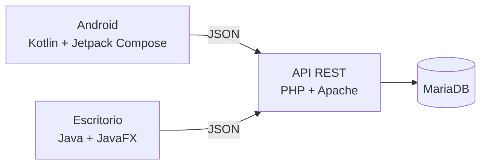

  <picture>
    <source media="(prefers-color-scheme: dark)" srcset="https://raw.githubusercontent.com/TallerConnect/.github/main/profile/img/logo-oscuro.png">
    
  </picture>

<h3 align="center">Sigue la reparación de tu coche sin llamar al taller</h3>

  
  
  
  
  
  

---

## Qué es

**TallerConnect** es un sistema multiplataforma para talleres mecánicos. El taller gestiona las reparaciones desde una aplicación de escritorio y el cliente consulta, desde el móvil, cómo va su coche: qué trabajos están hechos, cuáles faltan y cuánto tiempo queda.

Es un proyecto del módulo de **Proyecto Intermodular** de 2º de Desarrollo de Aplicaciones Multiplataforma (DAM).

## Qué permite hacer

| Administrador del taller · Escritorio | Cliente · Android |
|---|---|
| Gestionar clientes y vehículos | Registrarse o entrar con la cuenta que le crea el taller |
| Crear tareas de reparación con varias incidencias | Dar de alta sus vehículos |
| Asignar a cada incidencia el empleado que la realiza | Ver el progreso de la reparación en curso |
| Marcar las incidencias según se completan | Consultar el tiempo estimado y la espera |
| Mantener el catálogo de incidencias y los empleados | Revisar el historial de reparaciones |

## Arquitectura

Las dos aplicaciones usan la misma API, y toda la lógica de negocio vive en el servidor.

## Repositorios

| Repositorio | Qué contiene |
|---|---|
| **backend** | API REST en PHP y base de datos |
| **desktop** | Aplicación de escritorio (JavaFX) |
| **android** | Aplicación móvil (Kotlin, Jetpack Compose) |
| **docs** | Análisis, diseño, manuales y memoria del proyecto |

## Progreso

- [x] Análisis: requisitos, casos de uso e historias de usuario
- [x] Diseño de la base de datos (modelo entidad-relación)
- [ ] Diseño de la API REST
- [ ] Desarrollo del backend, del escritorio y de Android
- [ ] Pruebas y control de calidad
- [ ] Documentación y manuales

## Autores

**Eva Gallardo Romero** y **Carlos Valades Fernandez**
