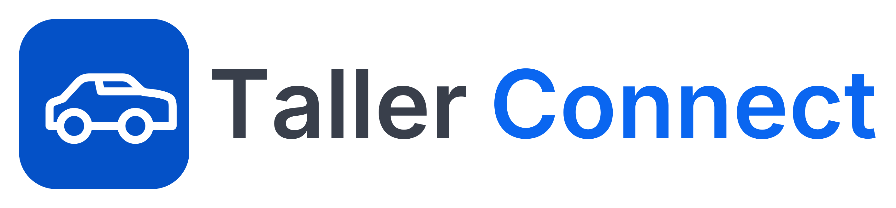

<p align="center">
  <picture>
    <source media="(prefers-color-scheme: dark)" srcset="https://raw.githubusercontent.com/TallerConnect/.github/main/profile/img/logo-oscuro.png">
    
  </picture>
</p>

# TallerConnect

**Sistema multiplataforma de gestión de talleres mecánicos.** Permite al taller gestionar las reparaciones de los vehículos desde una aplicación de escritorio, y al cliente consultar el estado de su coche desde el móvil, sin tener que llamar.

Proyecto Intermodular de 2º de Desarrollo de Aplicaciones Multiplataforma (DAM).

## Cómo funciona

El sistema tiene tres partes que se comunican a través de una API REST:

```
Android (Kotlin + Jetpack Compose)  ──┐
                                      ├──►  API REST (PHP + Apache)  ──►  MySQL / MariaDB
Escritorio (Java + JavaFX)  ──────────┘
```

| Parte | Para quién | Tecnología |
|---|---|---|
| **Aplicación de escritorio** | El administrador del taller | Java, JavaFX |
| **Aplicación móvil** | Los clientes del taller | Kotlin, Jetpack Compose, MVVM |
| **Backend y base de datos** | Ambas aplicaciones | PHP, Apache, MySQL/MariaDB |

## Repositorios

| Repositorio | Contenido |
|---|---|
| `backend` | API REST en PHP y script de la base de datos |
| `desktop` | Aplicación de escritorio (JavaFX) |
| `android` | Aplicación móvil (Kotlin, Jetpack Compose) |
| `docs` | Documentación del proyecto: análisis, diseño, manuales y memoria |

## Estado del proyecto

En desarrollo. Actualmente en la fase de diseño (requisitos, casos de uso, modelo de datos y diseño de pantallas).

## Autores

- Eva Gallardo Romero
- Carlos Valades Fernandez
